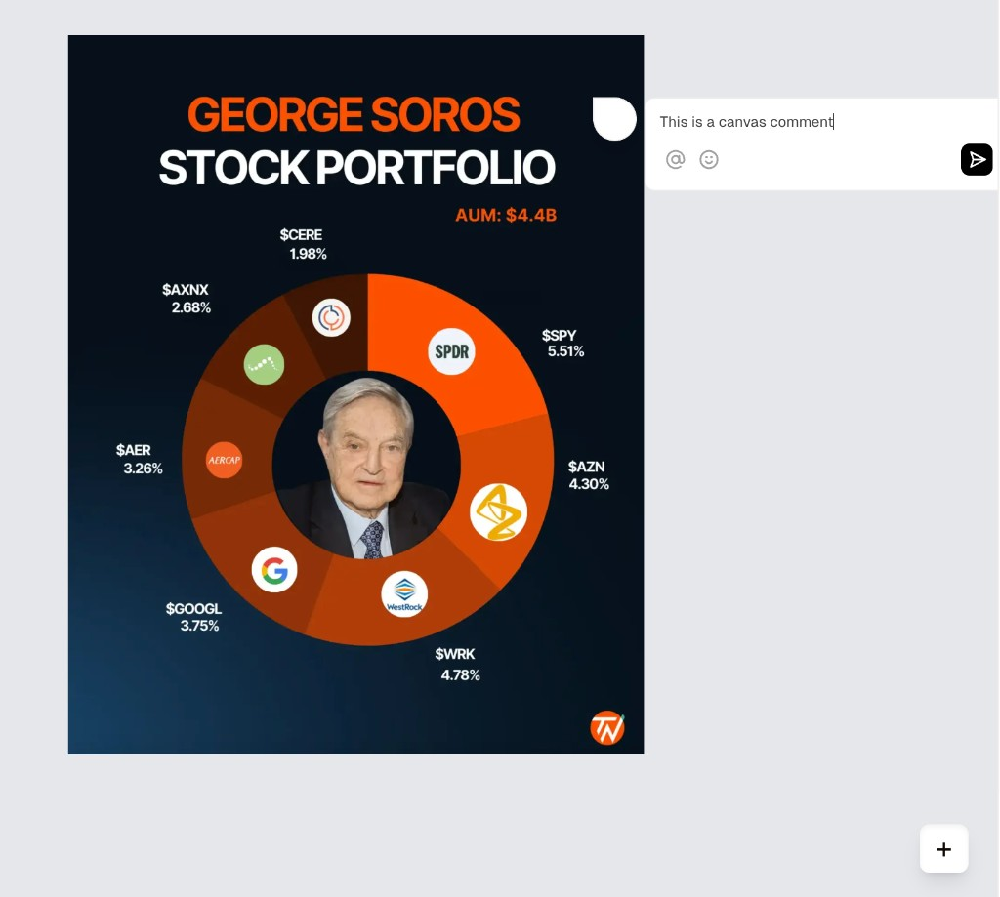

# Image Comments

A Figma-style commenting app for an image. Click anywhere on the image to leave a comment pinned to that exact spot, pan by dragging, and zoom with the controls, the wheel or a pinch. Comments sync live between everyone in the room through [Liveblocks](https://liveblocks.io).

Built for Part B of the case study. The original brief is [at the bottom of this file](#original-brief).

## Setup

You need Node.js 20.9 or newer and a free Liveblocks account.

1. Install the dependencies:

   ```bash
   npm install
   ```

2. Copy the example environment file and paste your **secret** key (it starts with `sk_`) from the [Liveblocks dashboard](https://liveblocks.io/dashboard/apikeys):

   ```bash
   cp .env.example .env.local
   ```

3. Start the dev server and open [http://localhost:3000](http://localhost:3000):

   ```bash
   npm run dev
   ```

4. Enter a name. To see real-time sync, open a second browser (or a private window) and enter a different name.

If the key is missing, the app shows a setup screen that says what to add.

### Scripts

| Command             | What it does                                                                                       |
| ------------------- | -------------------------------------------------------------------------------------------------- |
| `npm run dev`       | Starts the dev server                                                                              |
| `npm run test`      | Runs the unit tests (Vitest)                                                                       |
| `npm run lint`      | Runs ESLint                                                                                        |
| `npm run typecheck` | Runs the TypeScript compiler                                                                       |
| `npm run ci`        | Runs lint, type-check, tests and a production build, the same steps as the GitHub Actions workflow |

### Trying the error states

- **Image that doesn't load.** Open `http://localhost:3000/?image=/missing.png`. The `image` parameter accepts any http(s) URL or path on the site.
- **Lost connection.** Turn your network off for a few seconds. A banner appears after Liveblocks' grace period and clears when you're back.
- **Name in use.** Sign in with the same name in two different browsers.

## How it works

### Anchoring through pan and zoom

The hard part of the brief is keeping each comment on its spot at every zoom level. Three choices solve it:

1. **The app stores pins as fractions of the image**, from 0 to 1 (`{ x: 0.42, y: 0.17 }` in the thread's metadata). Zoom, pan and screen size never change a stored position, and two people with different window sizes see the pin on the same pixel.
2. **One transform moves everything.** The image sits at its natural size in a single layer moved by `translate(x, y) scale(s)`. Pins live inside that layer at `left: x * 100%; top: y * 100%`, so the browser applies the exact same transform to the image and the pins. They can't drift apart.
3. **Pins undo the scale** with `scale(calc(1 / var(--viewport-scale)))` around their top-left corner, which is the anchor point. They stay 32px on screen at any zoom.

The maths lives in pure, tested functions in [`src/lib/viewport.ts`](src/lib/viewport.ts). They convert between screen and image points, zoom around a point so it stays under the cursor, and fit the image to the screen.

### Pan and zoom

[`useViewport`](src/hooks/useViewport.ts) holds `{ x, y, scale }`. Until the user moves the view, it stays fitted to the window, including after a resize. It uses no library. Pointer events cover mouse, touch and pen.

- A press that moves more than 4px pans; anything shorter is a click.
- Ctrl/⌘ + wheel and trackpad pinch zoom around the cursor; a plain wheel or two-finger scroll pans.
- Two fingers on a touch screen pinch-zoom and pan together.
- The zoom buttons zoom around the centre, and the percentage button fits the image again. Zoom ranges from 10% to 800%.

### Left and right flip

[`getThreadSide`](src/lib/thread-placement.ts) follows the brief. A thread opens to the right of its pin, and flips to open inwards when the pin is too close to the image's right edge. "Too close" means less room on screen than the pin, gap and thread need (388px). Because it measures the distance on screen, zooming in gives an edge pin room again, and panning never changes the side.

The popover (Radix, inside Liveblocks) handles up and down. It shifts a thread to stay on screen and caps its height to the space available, and long threads scroll inside.

### Comments

- Click the image to open a composer there, or use the "Add a comment" button for a placement mode (Esc cancels). Clicks beside the image do nothing.
- If a thread or composer is open, a click on the image only closes it, so dismissing never drops a stray comment.
- A new comment opens its thread straight away. The composer creates the thread itself with `useCreateThread` to get its id.
- The author of a thread can drag its pin to a new spot. Other people's pins can't be moved.
- Authors can edit and delete their own comments from the comment menu (built into Liveblocks).
- A thread hides while its pin is panned off screen and comes back with it.

### Identity

There is no password. Users type a name, which becomes their Liveblocks user id, and the app keeps it in `localStorage` with a random browser id.

- The auth route ([`route.ts`](src/app/api/liveblocks-auth/route.ts)) validates the request with Zod and refuses a name, in any letter case, that another browser has connected to the room right now. A reload, a second tab or a reconnect from the same browser gets through.
- Two sign-ins at the same moment can both pass that check, so [`DuplicateNameGuard`](src/components/identity/DuplicateNameGuard.tsx) checks again after connecting. Liveblocks numbers connections in order, and the later one leaves.

### State

| State                                      | Owner                                                       |
| ------------------------------------------ | ----------------------------------------------------------- |
| Comments, threads, connection status       | Liveblocks (its own cache, optimistic updates and rollback) |
| Pan and zoom                               | React state in `useViewport`                                |
| Open thread, draft comment, placement mode | React state in `CommentsCanvas`                             |
| Name and browser id                        | `localStorage`, read with `useSyncExternalStore`            |

The app never copies comments into a second store, so updates from other users only change one place.

### Errors

| Situation                                               | What the user sees                                                                    |
| ------------------------------------------------------- | ------------------------------------------------------------------------------------- |
| Image loading                                           | A spinner; pins and the comment button wait for the image                             |
| Image fails to load                                     | "The image couldn't load" with a Try again button                                     |
| Empty or whitespace-only comment                        | The send button stays disabled (Liveblocks' composer)                                 |
| Connection lost                                         | A "Reconnecting…" banner, then "Back online"; a Retry button if reconnecting gives up |
| Comment, reply, edit or pin move rejected by the server | Liveblocks undoes the change and a toast explains what failed                         |
| Name empty, too long or in use                          | A message under the name field                                                        |
| Missing `LIVEBLOCKS_SECRET_KEY`                         | A setup screen saying what to add                                                     |
| The canvas crashes                                      | "Something went wrong" with Try again and Reload                                      |

### Project layout

```
src/
  app/                 Next.js app router: layout, page, providers, API routes
  components/
    canvas/            Image, pin anchor and shared canvas helpers
    identity/          Name screen, setup screen, badge, duplicate-name guard
    feedback/          Connection banner, error toasts, crash screen
    ui/                shadcn components
  hooks/               useViewport (pan and zoom), usePinDrag
  lib/                 Pure logic: viewport maths, thread side, identity, errors
```

## Decisions and trade-offs

- **The flip is measured against the image's right edge, as the brief says, not the screen's.** The browser's own collision handling still keeps a thread on screen when the screen edge is closer.
- **On phones, threads open below the pin.** On a screen narrower than a thread plus its pin (420px), no pin has room for a thread beside it on either side, so the thread opens below and slides sideways to stay fully visible. The left/right rule applies everywhere else.
- **Names identify people; they don't authenticate them.** A name can't be used by two browsers at the same time, but once someone leaves, the next person to type their name becomes them and can edit their comments. A real app would use a login provider.
- **One image and one room.** The image is a placeholder SVG drawn for this project (`public/images/sample.svg`), with a grid and labelled points that make any drift easy to spot.
- **Attachments, thread subscriptions and resolving are hidden.** Attachments aren't in the brief or the design reference. Subscribing only feeds a notifications inbox this app doesn't have, and a resolved thread would look the same as an open one, so both buttons did nothing visible.
- **Clicking the zoom buttons closes an open thread**, because Liveblocks treats it as a click outside. Wheel and pinch zoom keep it open.
- **A comment that fails to save loses its text.** Liveblocks rolls the comment back and the toast says so, but the draft isn't restored.

## Tests

The unit tests cover the two parts the brief names as hard: anchoring (screen and image conversion at every zoom, zooming around a point, zoom limits, fitting) and the left/right flip (the flip, its exact limit, zooming back in, small images, phones). Run them with `npm run test`. CI runs them on every push.

## AI usage

> **Draft: rewrite this in your own words before submitting.** The brief asks for your account of how you used AI, and you'll be asked about it live.

I used **Claude Code** (Claude Opus) throughout Part B. I used it to:

- question me about the design before writing code, one decision at a time (coordinates, pan/zoom, click behaviour, the flip, identity, errors, styling, tests)
- read the Liveblocks starter and library source to check what it already handles
- write the code in small steps and test each step in a browser, including the failure cases
- draft this README

Things it got wrong, and what I changed:

- **The flip rule.** It offered a screen-edge rule for the left/right flip, and I first agreed. The brief says the image's right edge, so I corrected it, and the rule now follows the brief.
- **Identity.** Its first proposal used the name as the user id with no check for names in use, which would let two people with the same name edit each other's comments at the same time. I pushed back, and we added the server check plus the after-connect check.
- **React Query.** It first suggested React Query for the sign-in call. There was nothing for it to do: Liveblocks calls the auth route itself and already caches comments, so I left it out.

---

# Original brief

Thank you for taking part in our hiring process. This case study is the second stage. It has one required coding task (Part B) and one optional written task (Part A).

**Deadline:** please submit within **72 hours** of receiving this link.

## Rules

1. **AI tools are allowed.** You may use any AI coding tools you like (Copilot, Cursor, Claude, ChatGPT and similar). The team you would join uses AI every day. What matters is that the result is good and that you understand it.
2. **You will explain it live.** If you move to the next stage, you will walk the team through your code and explain your decisions, line by line if asked. Only submit code you can fully explain, whoever or whatever wrote it.
3. **Add an AI usage note.** In your README, add a short section called "AI usage" covering: which tools you used, what you used them for, and at least one thing the AI got wrong or that you changed, and why.
4. **Commit in small steps.** Make regular commits with clear messages as you work. Your commit history helps us see your process.
5. **Partial is fine.** Focus on doing the core features well. A clean, working subset beats a rushed, complete one.

## Part B: Image Commenting App (Required)

Build a React app that lets users add comments to an image on a canvas, similar to commenting in design tools like Figma. Use [Liveblocks](https://liveblocks.io/docs) as the real time collaboration layer.

### Starter code

Start from the official Liveblocks canvas comments example:
[Liveblocks Canvas Comments Example](https://github.com/liveblocks/liveblocks/tree/main/examples/nextjs-comments-canvas)

Clone it, run `npm install` and `npm run dev`, and build from there.

**Liveblocks key:** the example needs a Liveblocks API key. Create a free account at [liveblocks.io](https://liveblocks.io), copy your secret key from the dashboard, and follow the example's README to add it to `.env.local`. Do **not** commit your key.

### Core features

**1. Image comments**

- Click anywhere on the image to add a comment anchored to that exact spot.
- Comment threads flip between left and right alignment based on position. If a comment is too close to the right edge of the image, it should open inwards.
- Comment positions must stay correct at every zoom level, so each comment stays on its original anchor point.

**2. Canvas interactions**

- Drag the image to pan.
- Zoom in and out controls.
- Comments keep their position relative to the image while panning and zooming.

### Optional features

- Responsive design for different screen sizes.
- Editing existing comments.

### Design reference

Use these as a guide. Working functionality matters more than matching the design exactly.




You may improve the design or add libraries if they help usability. Any icon library is fine.

### How we evaluate

Since AI tools are allowed, we care most about the quality of your decisions: how the code is structured, how you solved the hard parts (comments staying anchored through zoom and pan, the left and right flip), how you handle errors, and how well you can explain all of it.

- **Functionality:** does the app work as expected?
- **Code quality:** is the code organised, clean, maintainable and testable?
- **State management:** is state handled efficiently across components?
- **Error handling:** how does the app behave when things go wrong (for example a failed connection, an empty comment, or an image that does not load)?
- **UI and UX:** is the experience thoughtful and easy to use?

**Time expectation:** about 4 hours.

## Part A: Product Thinking (Optional)

This part is optional. Complete it if you have time. It is a good chance to show how you think about building the right thing, not just building things right.

Write your answer in `RESPONSE.md`. No code is needed. Expect about 60 to 90 minutes.

### The request

A customer of a content review platform has asked for this feature:

> "Users should be prevented from submitting for review until all AI suggestions have been actively reviewed and given a response."

### Product context

The platform helps teams prepare content before it goes to a human reviewer for approval. A typical flow:

1. A user creates or edits a piece of content.
2. The platform's AI generates suggestions about issues in that content.
3. The user can look through those suggestions.
4. The user submits the content for human review.

Today, users can submit for review without explicitly responding to the AI suggestions.

You have also heard from three stakeholders:

- One says users skip obvious AI suggestions, which creates unnecessary review rounds.
- Another wants a clearer audit trail showing that suggestions were considered.
- A third worries that a blanket rule will add friction and slow people down.

### Your task

Answer three things in `RESPONSE.md`:

1. **Questions you would ask.** What would you ask the customer or internal stakeholders to understand the problem and avoid building the wrong thing?
2. **How you would learn more without them.** The customer is unavailable for a week. What data, product behaviour, people or other sources would you look at to reduce uncertainty?
3. **A developer ready ticket.** Write the ticket you would hand to engineering. It should be specific enough to estimate and start work, and should clearly list open questions, assumptions and dependencies.

You do not need to design the UI in detail. Make reasonable assumptions and label them clearly. We care more about your thinking than finding one correct answer.

## How to submit

1. Click **Use this template** at the top of this repository to create your own copy (or clone it).
2. Build Part B in your repository, and add setup instructions to your README so we can run it in a few minutes.
3. If you do Part A, write it in `RESPONSE.md`.
4. Push your work to your own GitHub repository. If it is private, give access to this GitHub account.
5. Email the link to **info@limitlessoutsourcing.com** with the subject "Case Study: Your Full Name".

Good luck. We look forward to seeing your work.

Limitless Outsourcing Team
